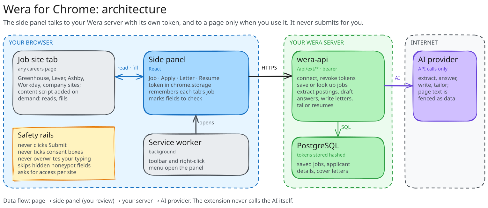

# Wera for Chrome

[](https://github.com/jessechumo/wera-extension/actions/workflows/ci.yml)
[](https://github.com/jessechumo/wera-extension/actions/workflows/ci.yml)
[](https://github.com/jessechumo/wera-extension/releases)
[](manifest.json)
[](e2e)
[](https://www.conventionalcommits.org)

A Chrome extension for [Wera](https://github.com/jessechumo/Wera): on any job page, save the job to your Wera lists, see how well it fits, write a cover letter, tailor your resume and fill in the application. **Wera never submits an application.** It fills what it knows, outlines what you should check, and you click Submit yourself.

## What it does

- **One Wera panel, in the page:** on job postings and application forms a Wera panel sits at the right edge of the page, in the dashboard's design (logo, Geist, colors) and the theme you picked there. On an application it opens on its own; on a posting it waits as a tab with Wera's mark at the edge of the page. Collapse it and it stays collapsed on that site; the toolbar icon (Alt+Shift+W) shows or hides it anywhere. It stays off pages that are not a job's own: mail (Gmail, Outlook), calendars, documents, chat, AI assistants and social feeds, where job emails and "Thank you for applying" messages are common, and pages that describe a job without a way to apply. It shows the job (fit score, tracker status, **Open in Wera**), one big button, and under it your resume and cover letter for this job. Deeper work (editing your resume, details, the letter) opens in the dashboard.
- **Autofill:** one button fills the application. What Wera knows from your details, resume and earlier answers goes in at once; the fields that are left go to the AI in parallel (from your profile, resume and earlier answers; never your self-identification) and each sure answer fills as it lands; open questions ("Why us?", "Tell me about a time when...") get a draft sized to the box, or your earlier answer to the same question. Custom dropdowns are opened and read first, so the AI picks from the real choices. Then the panel lists only what **Needs you**: required fields it could not fill, consents (never ticked for you), the AI's unsure guesses (one click to use), self-identification not in your profile, and answers it drafted for you to read. Anything that went wrong along the way (your resume could not be loaded, the AI did not answer) is said in plain words, with what to do. It never submits.
- **Never asks what you already told Wera:** your address, gender, race, Hispanic origin, veteran and disability status, pronouns and the rest of your details fill every form that asks, however it words them ("Man" for male, "Hispanic or Latino" in a combined race list, a lone "No, I do not have a disability" box ticked). Questions Wera can work out are answered too: "Have you worked here before?" from your resume's employers, "Are you located in the US?" and "Are you a Singapore citizen?" from your country and citizenship, the LGBTQ+ question from your orientation and gender identity, a single address box with your whole address, a list of countries or states from your city. Who referred you is left to you, never guessed.
- **Site rules, Jobright-style:** Wera knows the application systems people meet most by their own field names and widgets, on top of its general reading of any form:
  - **Workday:** both naming schemes (`legalNameSection_firstName`, `name--legalName--firstName`, `workExperience-2--jobTitle`), button dropdowns (long lists scrolled, each pick checked), search prompts (menus of categories followed, "No Items" flashes waited out, the pill checked), skills one pill at a time, split month/day/year dates, drawn radio groups, the step you are on ("Step 2 of 5 · My Experience"), its own Next button, and what its account pages want first (Wera fills your email, never a password). It paces itself, as Workday needs.
  - **Greenhouse** (job boards, older boards and embedded forms), **Lever** and **Ashby**: their own names for name, contact, location, links, education blocks and the EEO questions; Lever's "Additional information" takes your cover letter.
  - Everywhere else: what each field asks (name, contact, links, work authorization and sponsorship, clearance, citizenship, travel, work mode, notice period, education, jobs and schools, salary, self-identification), options picked by meaning ("USA" for United States, "TX" for Texas), react-select, place searches, Yes/No buttons, forms embedded from another site and web components, dates shaped to the box, the best resume PDF attached. A start date is never one that has passed.
- **The Wera button in open questions:** focus an open question on an application and Wera's mark appears in its corner. Click it for a draft from your profile, resume, earlier answers and the job (a story for "Tell me about a time when..."), then rework it: **Shorter**, **Longer**, **Again**, or tell Wera what to add or change. **Insert** puts it in the box; nothing is typed until you do.
- **Multi-page applications:** **Continue to the next page** saves what you entered, presses the page's Next / Save and Continue (never Submit), and fills the next page as it appears. On the last page it says so and leaves Submit to you. Each application is recorded in Wera (site, pages, fields).
- **Learns:** what you type or choose on a form is saved in Wera when you move it on (the site's own Next or Submit, or Wera's Continue), and offered the next time a form asks the same thing; details a form needed that Wera lacked go to your application details (self-identification in the dashboard's values, never sent to the AI). An answer that names the company it was written for ("Why Stripe?") is never given on another company's form. A start date typed for one job is not kept.
- **Your files:** the resume tailored to this job is attached when there is one, else your main resume, else the file you uploaded. The cover letter you have for this job goes in the box or is attached as a PDF; when the form asks for a cover letter (required, or named as one) and this job has none, Wera writes one from your resume and the posting, attaches it, and lists it for you to read (turn off with drafting in Settings).
- **Marks it applied, then closes the tab:** when the site says the application went through (its "thank you" message or confirmation page, also inside an embedded form) on the same site as the form the tab showed, the job moves to **Applied** in your tracker and the panel says so, with an undo; a job Wera does not have can be added as applied. Right after you press **Submit**, Wera adds a job it lacked from its posting, shows an alert on the page saying what it did, and closes the tab after 5 seconds (**Stay on this page** keeps it; the last tab of a window goes to your tracker instead). Turn closing off in Settings.
- **With the dashboard:** "Apply on the company's site" in the dashboard tells the extension which job the new tab is for, even when the site's address differs; changes either side refresh the other. The fit score shows on the toolbar icon for the tab.
- **Shortcuts:** Alt+Shift+W shows or hides Wera; Alt+Shift+F (or right-click, "Fill this application with Wera") fills the form. Change them at chrome://extensions/shortcuts.
- **Settings:** the gear in the panel: AI answers, drafting open questions while filling, the Wera button, filling the next page on Continue, learning, marking applied, closing the tab after applying, showing Wera on job pages, the Debug log, signing out.

## Architecture

<picture>
  <source media="(prefers-color-scheme: dark)" srcset="docs/architecture-dark.svg">
  
</picture>

- `src/page`: the page script, in every frame of every page (never your Wera server). It tells postings and forms from other pages (`src/content/detect.ts`), asks for the panel on them, answers the panel (read the page, plan and fill the form, press Next), adds the Wera button to open questions, and watches for the confirmation after you submit. On pages Wera is not used on it only checks whether they are job pages.
- `src/content`: the form engine the page script uses, pure DOM code unit-tested against fixture forms cut from real ones:
  - `fields.ts` reads every field and its label as a person would; `classify.ts` says what each asks; `entries.ts` numbers job and school blocks.
  - `values.ts` works out what to enter from your details; `match.ts` picks the choice that means it; `places.ts` knows states and countries by any name.
  - `plan.ts` reads a page into a plan (each field, what Wera proposes and why) and fills what you approved; `fill.ts` drives the page's widgets.
  - `sites/` holds the Workday, Greenhouse, Lever and Ashby rules and Workday's widget filling.
- `src/panel`: the Wera panel (React), put into a job page's top frame on demand, inside a closed shadow root it keeps on the page (some sites rebuild the whole document once loaded). `useAutofill.ts` runs an autofill; `rows.ts` holds the rules for what Wera fills, asks the AI, drafts or leaves to you.
- `src/background`: the service worker. It puts the panel on the page, relays the panel's and the Wera button's calls to your Wera server (a page script cannot reach it) and to the page's frames (an embedded form is filled in its own frame), looks the page's job up, marks jobs applied, and ties a tab the dashboard opens to its job.
- `src/bridge`: runs only on your Wera dashboard (registered for the server you signed in to). It passes which job a posting link opens, "something changed" in both directions, and your theme.
- `src/shared`: the API client, storage, settings and shared types; `rpc.ts` types every request the panel makes of the background and the frames; `errors.ts` turns any failure into words for the user; `log.ts` is the one log every part writes to.

The server side lives in the Wera repository (`/api/ext/*`, `/api/applicant`, `/api/applicant/answers`, `/api/autofill-runs`); the dashboard lists connected browsers under Settings and holds your application details and saved answers under Profile.

## Privacy and permissions

- Permissions: `storage`, `activeTab`, `scripting`, `contextMenus`, and access to the sites you visit (Chrome shows it as "read and change all your data on all websites"). Wera needs it to tell a job page from any other on its own and to fill forms there, including forms embedded from another site. On other pages it only checks, in the page, whether they are one; nothing is sent.
- The extension talks only to your own Wera server, from its service worker. Your password is sent once to get a token; the token is stored in `chrome.storage.local` and can be revoked in Wera's Settings.
- What Wera draws on pages sits in closed shadow roots: the page cannot read your fit score or drafts.
- Page text sent to the AI is fenced as untrusted data in every prompt.
- On a job page, Wera sends your Wera server the page's address (and, on a posting, its schema.org job data) to look the job up; on a page that says your application went through, its address.
- The dashboard bridge runs only on your own Wera server's pages and accepts messages only from that origin; it passes job ids and posting addresses, nothing else.
- Answers you give on forms are saved to your own Wera server (turn learning off in Settings; forget them in the dashboard). Self-identification answers are never sent to the AI.

## Install (development)

```sh
npm install
npm run build          # dist/
```

Open `chrome://extensions`, turn on Developer mode, click **Load unpacked** and choose `dist/`. Open a job page: the Wera panel appears (or click the Wera icon). Sign in there with your Wera address (for example `http://192.168.4.68:3000`).

`npm run dev` rebuilds on change.

## Quality checks

```sh
npm run lint        # ESLint, no warnings allowed
npm run typecheck
npm test            # Vitest: form engine and site rules on fixture forms, the panel, the Wera button, the background
npm run coverage
npm run e2e         # the real extension in Chromium against a Wera API (see playwright.config.ts)
WERA_E2E_AI=1 npm run e2e   # also drafts, reworks and inserts an answer with the Wera button and the live AI
```

The end-to-end tests load the built extension into Playwright's Chromium, sign in through the panel on a fixture posting, save it, autofill its application (checking that the resume is attached and that the consent box and Submit are left alone), continue a multi-step form to its last page, fill a form embedded from another site (again after a reload), check that submitting moves the job to Applied and the alert closes the tab, that a mail inbox full of job emails gets no panel, that the panel steps aside when a page stops being a job page, and that the dashboard hands a tab its job.

## Debugging

- **Debug log** (Settings): every part of Wera writes what it read and did to its own console, as `[wera:scope]` lines: the page's console for the form engine and the panel (each field, what Wera read it as, what it proposed, what happened), the service worker's for requests to Wera. Warnings and errors are written there always.
- **Copy diagnostics** (under the panel, after a fill): copies a report of the page (each field's kind, what Wera read it as, its value and how filling went; self-identification answers hidden) with the recent log of the panel and of each frame. Paste it into an issue.
- Errors say what failed and what to do ("Couldn't load your resume, so Wera won't attach it. Your Wera server isn't answering (error 502)…"), never a bare status code; see `src/shared/errors.ts`.
- End-to-end tests: `WERA_E2E_LOG=1` prints every page's console and the service worker's; a failed test leaves a screenshot of each open page in `test-results/`.

## Releases

Commits follow [Conventional Commits](https://www.conventionalcommits.org). release-please keeps a release PR with the next version and `CHANGELOG.md`; merging it tags the release and attaches `wera-extension-<version>.zip`, ready to upload to the Chrome Web Store. `npm run package` builds the same zip locally.

## Layout

```
src/page/         page script in every frame: job pages, the panel, the Wera button, confirmations
src/content/      form engine: page reading, field detection, classification, filling; sites/ rules
src/panel/        the Wera panel (React, in the page)
src/background/   service worker: panel, relays to Wera and the frames, job lookups
src/bridge/       script on the Wera dashboard: job handoffs, change notices, theme
src/shared/       API client, typed requests, storage, settings, errors, log, types
e2e/              Playwright tests and fixture pages
scripts/          build, package, icons
docs/             architecture diagram (Excalidraw source in docs/diagrams)
```
